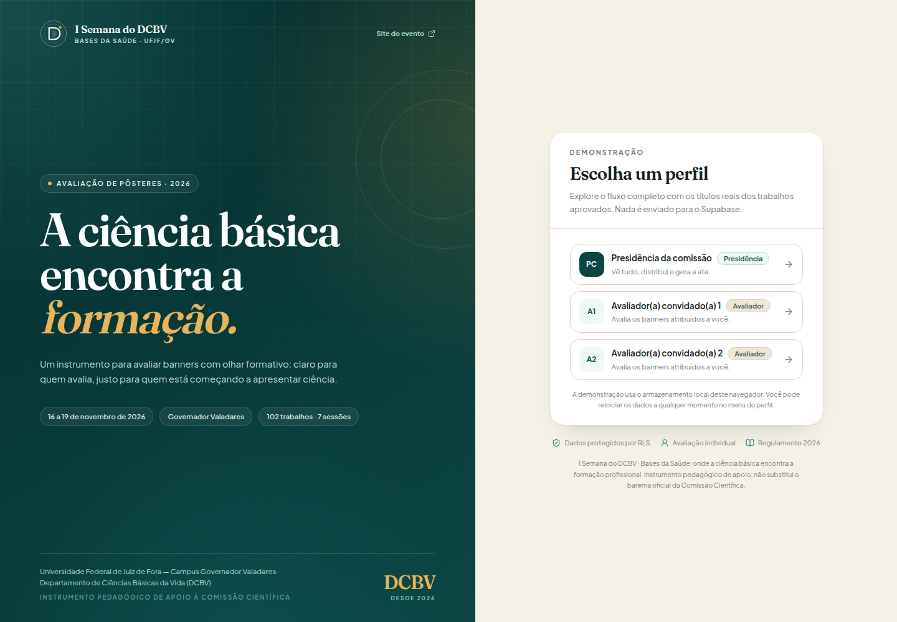
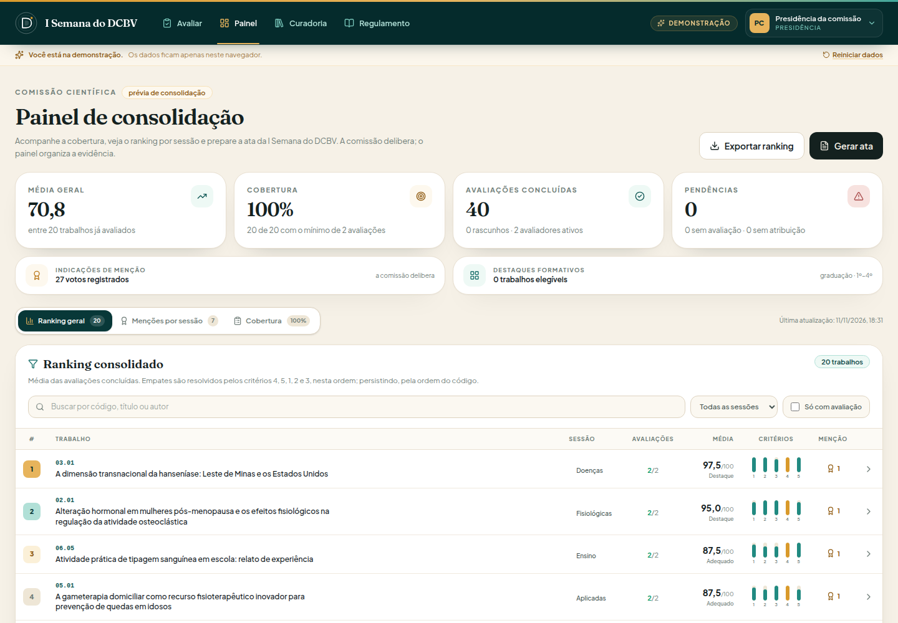
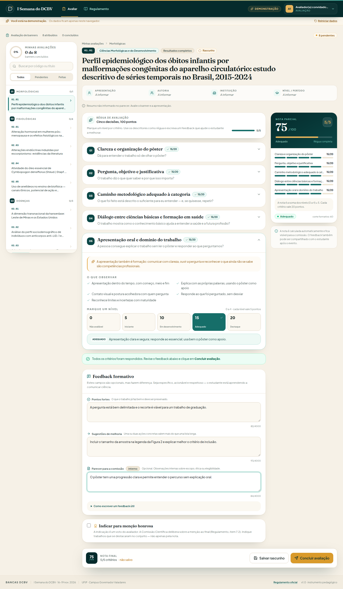
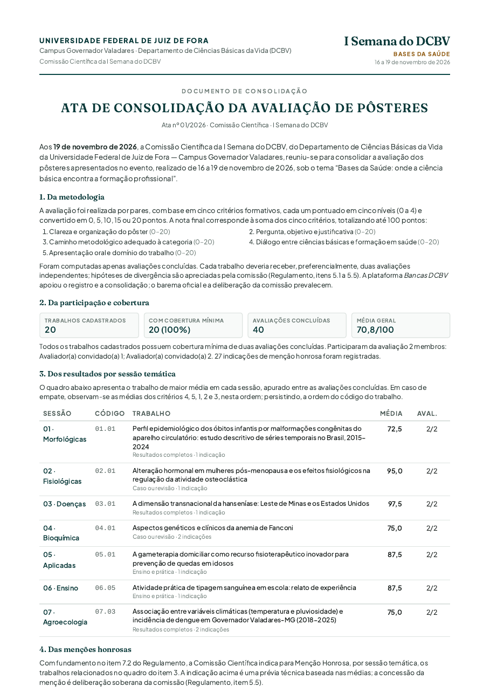

# Bancas DCBV

Aplicativo web de apoio à **avaliação formativa dos banners da I Semana do DCBV** — *Bases da Saúde: onde a ciência básica encontra a formação profissional* — UFJF, Campus Governador Valadares, 16 a 19 de novembro de 2026.

O app foi construído a partir do convite do Prof. Dr. Márcio Luís Moreira de Souza (DCBV/UFJF-GV) e se inspira no fluxo do [Prêmio UNIVALE](https://premio-univale.vercel.app/), sem copiar o instrumento de mestrado. A adaptação é deliberadamente mais simples: **cinco decisões explícitas**, com descritores observáveis, em vez de quinze cliques rápidos.

> **Em uma frase:** a banca registra notas e feedback com critérios claros; a presidência enxerga cobertura, ranking e uma minuta de ata. A comissão delibera; o app organiza a evidência.

---

## Capturas

| | |
|---|---|
|  |  |
| **Entrada e escolha de perfil** | **Painel com ranking, cobertura e ata** |
|  |  |
| **Cinco critérios, nota automática e feedback** | **Ata de consolidação em A4** |

Mais telas em [`docs/capturas/`](docs/capturas/): menções por sessão, cobertura, curadoria,
distribuição, regulamento e versão mobile. A minuta de exemplo está em
[`docs/ata-exemplo.pdf`](docs/ata-exemplo.pdf).

---

## 1. O que o app faz

| Para quem | O que resolve |
|---|---|
| **Avaliador(a)** | Vê só os banners atribuídos a si; pontua cinco critérios de 0 a 4; escreve pontos fortes, sugestões e parecer; indica (ou não) menção honrosa com justificativa; salva rascunho e retoma depois. |
| **Presidência / Comissão Científica** | Cadastra trabalhos e membros, importa o CSV do parecer, distribui avaliações, acompanha cobertura, vê ranking por sessão, exporta CSV e gera a ata em PDF. |
| **Quem só quer conhecer** | Entra no **modo demonstração**, sem senha e sem tocar no Supabase. |

O app **não** decide aprovação, **não** substitui o parecer da comissão e **não** envia e-mails. A ata é uma minuta de apoio, sujeita a revisão e assinatura.

---

## 2. A adaptação honesta ao público de graduação

O instrumento de referência foi pensado para trabalhos de pós-graduação: 15 itens Likert (15–75) mais uma nota livre do professor (0–25), totalizando 100. Para um calouro apresentando o primeiro banner, isso produz três problemas:

1. **Cansaço cognitivo:** quinze julgamentos em poucos minutos viram cliques rápidos, não leitura atenta.
2. **Falsa precisão:** a nota livre de 25 pontos mistura impressão geral com critério, e dois avaliadores chegam a resultados muito diferentes.
3. **Pouco ensino:** o estudante recebe um número, não uma explicação sobre o que melhorar.

A proposta deste app:

- **5 critérios × 20 pontos = 100**, cada critério com **5 níveis ancorados** (0 a 4). Cada nível vale 5 pontos.
- Sem nota livre: toda a nota vem de descritores que o avaliador consegue observar no pôster e na apresentação.
- O feedback textual é parte do fluxo, não um extra.
- A menção honrosa é **qualitativa** e não altera a nota.
- O “destaque formativo” é um reconhecimento **pedagógico**, não uma categoria oficial do Regulamento.

### Os cinco critérios

| # | Critério | Pergunta que o avaliador faz |
|---|---|---|
| 1 | Clareza e organização do pôster | Dá para entender o trabalho só de olhar o pôster? |
| 2 | Pergunta, objetivo e justificativa | O trabalho diz o que quer saber e por que isso importa? |
| 3 | Caminho metodológico adequado à categoria | O método combina com a pergunta e com a categoria escolhida? |
| 4 | Diálogo entre ciências básicas e formação em saúde | O trabalho conecta o conhecimento básico com a formação ou o cuidado? |
| 5 | Apresentação oral e domínio do trabalho | Quem apresenta entende o que fez e consegue explicar sem ler? |

Cada critério tem uma justificativa pedagógica (“por que isso importa”) e uma lista de “o que observar”. A íntegra está em [`src/data/rubric.ts`](src/data/rubric.ts) e também dentro do app, na aba **Regulamento**.

### Como a nota é calculada

```text
nota = (nível do critério 1 + ... + nível do critério 5) × 5
```

- Níveis: `0 = Não avaliável`, `1 = Iniciante`, `2 = Em desenvolvimento`, `3 = Adequado`, `4 = Destaque`.
- Faixas: `0` Sem nota; `1–59` Iniciante; `60–74` Em desenvolvimento; `75–89` Adequado; `90–100` Destaque.
- Empates no ranking: média geral, depois médias dos critérios **4, 5, 1, 2, 3**, nesta ordem; persistindo, ordem do código.
- A cobertura mínima é de **2 avaliações concluídas por trabalho**. Uma única avaliação aparece no ranking como prévia, mas não conta como cobertura completa.

A faixa exata e os rótulos ficam em [`src/data/rubric.ts`](src/data/rubric.ts) e [`src/lib/scoring.ts`](src/lib/scoring.ts).

---

## 3. Rodando localmente

Pré-requisitos: **Node.js 20+** e npm.

```bash
git clone https://github.com/profmsouzaoficial/avaliacao-semana-dcbv.git
cd avaliacao-semana-dcbv
npm install
npm run dev
```

Abra <http://localhost:3000>.

### Modo demonstração (recomendado para conhecer)

| URL | Perfil |
|---|---|
| `http://localhost:3000/?demo=1` | tela de escolha de perfil (sem senha) |
| `http://localhost:3000/?demo=presidencia-demo` | presidência: painel, curadoria e ata |
| `http://localhost:3000/?demo=avaliador-demo-1` | avaliador com 8 banners atribuídos |
| `http://localhost:3000/?demo=avaliador-demo-2` | outro avaliador, com outra distribuição |

Os dados da demo ficam no `localStorage` **daquele navegador**. O menu do perfil permite **Reiniciar dados** para voltar aos 20 trabalhos e 3 perfis de exemplo. Nada é enviado ao Supabase.

### Modo Supabase (uso real)

1. Siga [`supabase/README.md`](supabase/README.md) para criar o projeto e rodar a migração.
2. Copie `.env.example` para `.env.local` e preencha **uma** das formas:
   - `VITE_SUPABASE_URL` + `VITE_SUPABASE_ANON_KEY` (padrão do Vite);
   - `SUPABASE_URL` + `SUPABASE_ANON_KEY` (nomes usados pela integração Supabase da Vercel).
3. Reinicie o `npm run dev`.
4. Entre com o e-mail e a senha criados no Supabase Auth.

> **Não há senha padrão.** O seed do banco cria o perfil da presidência, mas não
> cria credenciais. Defina a senha ao criar o usuário em **Authentication >
> Users**; para um usuário existente, use a opção de redefinir senha no mesmo
> painel. A chave anon e a senha do Postgres não são a senha do app.

O prefixo `VITE_` **não é uma senha**: é só a marca do Vite para o que pode ser embutido no bundle. A chave anon/publishable é pública por design, e o RLS protege os dados. O build injeta apenas URL e chave pública; ele recusa a `service_role`. Sem essas variáveis, o app abre em demonstração — útil para conhecer o fluxo sem tocar no banco. Se o schema ainda não estiver aplicado, a tela de login mostra o aviso e o caminho para corrigir.

### Build de produção

```bash
npm run build
npm run preview
```

O build roda `tsc --noEmit` antes do Vite. A saída fica em `dist/`.

---

## 4. Papéis e privacidade

| Papel | Vê trabalhos | Vê avaliações | Gerencia cadastros |
|---|---|---|---|
| **Presidência** | todos | todas | sim |
| **Avaliador(a)** | só os atribuídos a si | só as suas | não |
| **Anônimo** | nada | nada | nada |

Essas regras são aplicadas no **banco**, por RLS (Row Level Security), não apenas na interface. As funções `meu_avaliador_id()`, `eh_presidente()` e `tem_atribuicao()` são `security definer` para evitar recursão de políticas. A função `proteger_presidencia()` impede que a última presidência ativa seja excluída, desativada ou rebaixada por engano.

O app não compara senhas no cliente: quem autentica é o Supabase Auth. A senha nunca passa pelo código da aplicação. O e-mail dos membros é visível para pessoas autenticadas (a lista é usada na gestão); notas e pareceres ficam restritos à banca.

> **Privacidade dos estudantes:** o parecer oficial não traz autoria, apresentador, instituição nem período. Esses campos ficam **em branco** na demo e devem ser preenchidos pela comissão no modo real, com consentimento e finalidade definidos.

---

## 5. Curadoria: trabalhos, membros e distribuição

A aba **Curadoria** (só presidência) tem três passos:

1. **Traga os trabalhos** — importe o CSV do parecer ou cadastre manualmente. O código `NN.NN` é a chave; importar de novo atualiza os existentes.
2. **Cadastre a banca** — nome, e-mail, titulação, instituição, papel e status. No Supabase, cada pessoa precisa de um usuário no Auth com o mesmo e-mail; o vínculo é automático no primeiro login.
3. **Distribua as avaliações** — clique nas células da matriz. Cada trabalho deve ter dois avaliadores. O botão **Completar distribuição** sugere avaliadores que ainda não estão naquele trabalho.

### CSV

O botão **Modelo** baixa um CSV com cabeçalho e uma linha de exemplo. Colunas aceitas:

```text
codigo,titulo,sessao,categoria,apresentador,autores,orientador,instituicao,periodo,nivel,resumo,link_pdf,observacoes
```

- `codigo`: `NN.NN` (obrigatório).
- `sessao`: 1 a 7; `categoria`: 1 a 5.
- `nivel`: `graduacao`, `pos-graduacao`, `docente` ou `outro`.
- Separador: vírgula, com suporte a aspas; também aceita ponto e vírgula.
- O importador valida e mostra **válidos, erros e avisos** antes de confirmar. Nada é importado pela metade: se houver erro de leitura, a lista de erros é exibida.

---

## 6. Ata e PDF

No painel, **Gerar ata** abre uma prévia A4 com:

- data da consolidação (editável);
- participantes e cobertura;
- média geral e médias por sessão;
- trabalho de maior média por sessão (prévia de menção);
- indicações de menção registradas;
- sugestão de destaque formativo (graduação, 1º–4º período, critério 4 ≥ 15/20);
- observações da comissão.

O botão **Imprimir / salvar PDF** usa a impressão do navegador com `@page A4` e `#print-portal`. Escolha **Salvar como PDF** no destino. O documento é uma **minuta**: revise, complemente e assine antes de publicar.

---

## 7. Supabase

O esquema está em [`supabase/migrations/0001_init.sql`](supabase/migrations/0001_init.sql). Ele cria as quatro tabelas, as funções de autorização, as políticas de RLS, a proteção da presidência e os 20 trabalhos da demo.

Passo a passo, incluindo o bootstrap da primeira presidência, em [`supabase/README.md`](supabase/README.md).

### Segurança em uma frase

A chave publishable/anon é pública; **a proteção vem do RLS**. Nunca coloque a `service_role` no front-end.

---

## 8. Deploy no Vercel

1. Importe o repositório em <https://vercel.com/new>.
2. Preset **Vite**; build `npm run build`; output `dist`.
3. Em **Settings > Environment Variables**, adicione **uma** das duplas:
   - `VITE_SUPABASE_URL` + `VITE_SUPABASE_ANON_KEY` (padrão); ou
   - `SUPABASE_URL` + `SUPABASE_ANON_KEY` (nomes da integração Supabase da Vercel).
4. Faça o deploy.

O prefixo `VITE_` não torna a chave secreta — ele apenas permite que o Vite a embuta no navegador. Use sempre a chave anon/publishable; o build bloqueia `sb_secret_` e JWTs com papel `service_role`.

As variáveis são embutidas no bundle em tempo de build; mudou a chave, precisa de novo deploy. O app não usa rotas no servidor (só query string `?demo=`), então não é necessário rewrite de SPA.

---

## 9. Testes

```bash
npm run lint        # tsc --noEmit
npm run build       # type-check + bundle
npm run test:e2e    # smoke test com Playwright
```

O smoke test:

- sobe o Vite se ainda não houver servidor em `http://127.0.0.1:3000`;
- entra na demo como presidência;
- confere curadoria e modais;
- entra como avaliador, pontua os 5 critérios, escreve feedback e conclui;
- volta como presidência e confere a avaliação no painel;
- abre a ata;
- testa o layout mobile (390 px) e verifica se não há rolagem horizontal;
- grava capturas em `e2e/artifacts/`.

Na primeira vez, instale o navegador:

```bash
npx playwright install chromium
```

Se já houver um Chromium instalado em `~/.cache/ms-playwright`, o script o reaproveita. Também é possível apontar um caminho:

```bash
PLAYWRIGHT_CHROMIUM_EXECUTABLE_PATH=/caminho/para/chrome npm run test:e2e
```

---

## 10. Estrutura do projeto

```text
src/
  data/
    event.ts        evento, sessões, categorias, links oficiais
    rubric.ts       os 5 critérios, níveis e cálculo da nota
    demo.ts         20 trabalhos e 3 perfis de demonstração
  lib/
    scoring.ts      ranking, desempate, cobertura, resumos
    csv.ts          importação/exportação CSV
    repository.ts   DemoRepository (localStorage) e SupabaseRepository
    supabase.ts     cliente e mensagens de erro
    format.ts       datas, notas, contagem com concordância
  context/
    AppContext.tsx  estado global, login, salvamento e toasts
  components/       telas e componentes de interface
  types.ts          contratos de dados
supabase/
  migrations/0001_init.sql
  seed_presidente.sql
  README.md
e2e/
  smoke.mjs
```

O app usa **React 19 + TypeScript + Vite 8 + Tailwind CSS v4 + lucide-react + Supabase JS**. As fontes são Fraunces (títulos) e Plus Jakarta Sans (texto), via Google Fonts.

### Dois modos, um contrato

`DemoRepository` e `SupabaseRepository` implementam a mesma interface `Repositorio`. A interface de usuário não sabe onde os dados moram; isso permite demonstrar sem credenciais e trocar para o banco real sem reescrever as telas.

---

## 11. Decisões de projeto (e o que ficou de fora)

- **Cinco critérios, não quinze.** Menos itens, mais leitura; cada nível tem descritor observável.
- **Nada de nota livre.** A nota é a soma dos critérios; o feedback é qualitativo.
- **Duas avaliações por trabalho.** A prévia com uma avaliação é sinalizada; não vira cobertura.
- **Menção honrosa é indicação, não nota.** O avaliador justifica; a comissão delibera.
- **Destaque formativo é pedagogia, não regra.** Não cria uma nova categoria no Regulamento.
- **Ata é minuta.** O app não assina, não publica e não substitui a deliberação.
- **Não há envio de e-mail.** Usuários do Auth são criados pela presidência no Supabase.
- **Não há upload de PDF.** O campo `link_pdf` guarda uma URL; o app não hospeda arquivos.
- **O parecer não foi inventado.** Os 20 títulos da demo vêm do parecer oficial; autoria, apresentador, instituição e período ficaram em branco porque o documento não os informa.

### Limitações conhecidas

- O PDF da ata depende da impressão do navegador; o layout foi pensado para A4, mas cada navegador pode variar margens de cabeçalho/rodapé.
- A demo usa `localStorage`: não sincroniza entre navegadores e pode ser apagada pelo usuário.
- O modo Supabase exige aplicar a migração manualmente; sem `VITE_SUPABASE_URL` e `VITE_SUPABASE_ANON_KEY`, o app permanece em demonstração.
- O ranking não corrige notas divergentes automaticamente: a comissão vê os dados e delibera (Regulamento, itens 5.4 e 5.5).
- O app não tem upload de arquivos, notificações por e-mail nem integração com o sistema acadêmico.

---

## 12. Referências do evento

- [Site do evento](https://www2.ufjf.br/dcbv/evento-cientifico-dcbv/)
- [Regulamento](http://www2.ufjf.br/dcbv/wp-content/uploads/sites/546/2026/09/REGULAMENTO_V%C3%A1lido.pdf)
- [Parecer dos resumos](http://www2.ufjf.br/dcbv/wp-content/uploads/sites/546/2026/11/PARECER_RESUMOS1.pdf)
- [Orientações para o resumo](http://www2.ufjf.br/dcbv/wp-content/uploads/sites/546/2026/09/Orienta%C3%A7%C3%B5es_resumo.pdf)
- [Orientações para o banner](http://www2.ufjf.br/dcbv/wp-content/uploads/sites/546/2026/11/Orienta%C3%A7%C3%B5es-para-apresenta%C3%A7%C3%A3o-e-confec%C3%A7%C3%A3o-de-banner.pdf)
- [Template do pôster](http://www2.ufjf.br/dcbv/wp-content/uploads/sites/546/2026/11/Template-padr%C3%A3o-para-p%C3%B4steres-I-Bases-da-Sa%C3%BAde.pdf)
- [Programação](http://www2.ufjf.br/dcbv/wp-content/uploads/sites/546/2026/11/Programacao_I_Semana_DCBV_Bases_da_Saude_FINAL.pdf)

---

**Contato da comissão:** `semanadcbv@gmail.com`

**Versão:** 1.0 · instrumento pedagógico de apoio à Comissão Científica da I Semana do DCBV.
